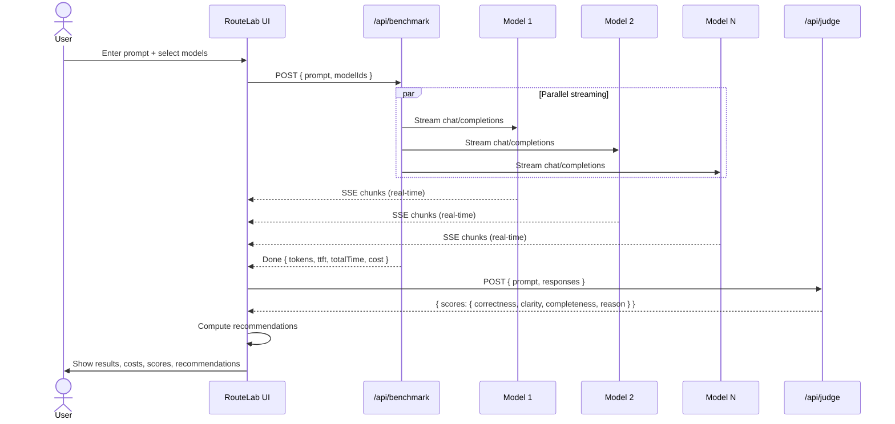

# RouteLab

**Compare open-source LLMs side by side. Pick the best model for your task — based on quality, speed, and cost.**

<!-- TODO: Add a GIF/screen recording of the app in action -->

## Why RouteLab?

Choosing the right LLM is hard. Every model has a different strength, speed, and price. RouteLab lets you paste a task, select 2–4 models, and see them run **in parallel** — streaming responses into side-by-side cards with real-time metrics.

- **Quality scores** from an LLM judge (correctness, clarity, completeness)
- **Cost breakdown** per model with per-token pricing
- **Recommendations** for best quality, cheapest, fastest, and best value
- **Budget tracking** with session spend history (localStorage)
- **Export** results as Markdown reports or copyable summaries

## Quick Start

```bash
git clone https://github.com/Aniruddhchilla2407/Alan-AI-OpenFire.git
cd Alan-AI-OpenFire/route-lab
npm install
```

### 1. Run in mock mode (no API keys needed)

```bash
echo "MOCK_MODE=true" > .env.local
npm run dev
```

Open [http://localhost:3000](http://localhost:3000). The app returns realistic fake responses so you can explore without spending any credits.

### 2. Run with real models

```bash
cp .env.example .env.local
```

Edit `.env.local` and add your API keys:

- `DEEPSEEK_API_KEY` — from [platform.deepseek.com](https://platform.deepseek.com)
- `OPENROUTER_API_KEY` — from [openrouter.ai/keys](https://openrouter.ai/keys) (covers Qwen, Llama, Gemini, Claude)
- `NVIDIA_API_KEY` — from [build.nvidia.com](https://build.nvidia.com)

Then:

```bash
npm run dev
```

## Deploy to Vercel

[](https://vercel.com/new/clone?repository-url=https://github.com/Aniruddhchilla2407/Alan-AI-OpenFire&root-directory=route-lab)

## How It Works



## Architecture

```
route-lab/
├── app/
│   ├── layout.tsx              # Root layout (dark theme)
│   ├── page.tsx                # Main page — orchestration hub
│   ├── globals.css             # Tailwind + custom styles
│   └── api/
│       ├── benchmark/route.ts  # Parallel streaming endpoint
│       └── judge/route.ts      # LLM judge scoring endpoint
├── components/
│   ├── PromptInput.tsx         # Text area + preset picker + run button
│   ├── ModelSelector.tsx       # Multi-select model chips (grouped by provider)
│   ├── BenchmarkCard.tsx       # Streaming response card with metrics
│   ├── ResultsBanner.tsx       # Recommendations: quality, cheapest, fastest, value
│   ├── BudgetTracker.tsx       # Session spend tracker (localStorage)
│   └── ExportButton.tsx        # Markdown export + summary copy
├── config/
│   └── models.ts              # All model configs (add yours here)
├── lib/
│   ├── cost.ts                # Token cost calculation
│   ├── mock.ts                # Mock response generator
│   └── recommendations.ts     # Best quality / cheapest / fastest / best value
├── __tests__/
│   ├── cost.test.ts
│   └── recommendations.test.ts
├── .env.example
├── LICENSE
└── README.md
```

## Adding a New Model

Add 5 lines to `config/models.ts`:

```ts
{
  id: "provider/model-name",
  displayName: "My Model",
  provider: "MyProvider",
  baseURL: "https://api.myprovider.com/v1",
  apiKeyEnv: "MYPROVIDER_API_KEY",
  pricePer1MInput: 0.50,
  pricePer1MOutput: 1.00,
  maxTokens: 8192,
}
```

Then add the corresponding env var to `.env.example`. That's it — the model appears in the UI automatically.

## Technology

- **Next.js 16** (App Router) + **TypeScript**
- **Tailwind CSS** for styling
- **OpenAI-compatible API** — any provider with a `/v1/chat/completions` endpoint works
- **Server-Sent Events (SSE)** for real-time streaming
- **Vitest** for unit tests

## Safety & Rate Limiting

- **Mock mode** via `MOCK_MODE=true` — explore the app without spending credits
- **Per-IP rate limiting** (20 req/min) on the benchmark endpoint
- **Prompt length capped** at 16,384 characters
- **max_tokens capped** at 8,192 per request
- API keys from environment variables only — never hardcoded
- Optional "bring your own key" input (browser-only, never sent to server unless used)

## Built with Alan AI + Open Models

RouteLab was built with [Alan AI](https://alan.app), using open-source LLMs for development and testing. The entire app was scaffolded, implemented, and tested with AI assistance — demonstrating that great developer tools can be built by AI, for AI.

---

MIT License · [GitHub](https://github.com/Aniruddhchilla2407/Alan-AI-OpenFire)